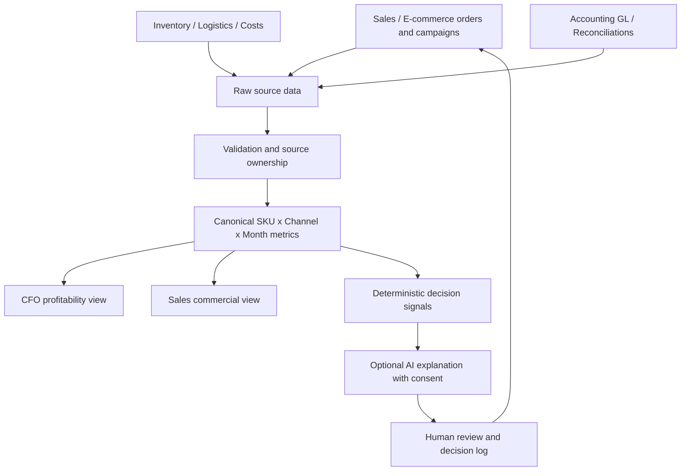
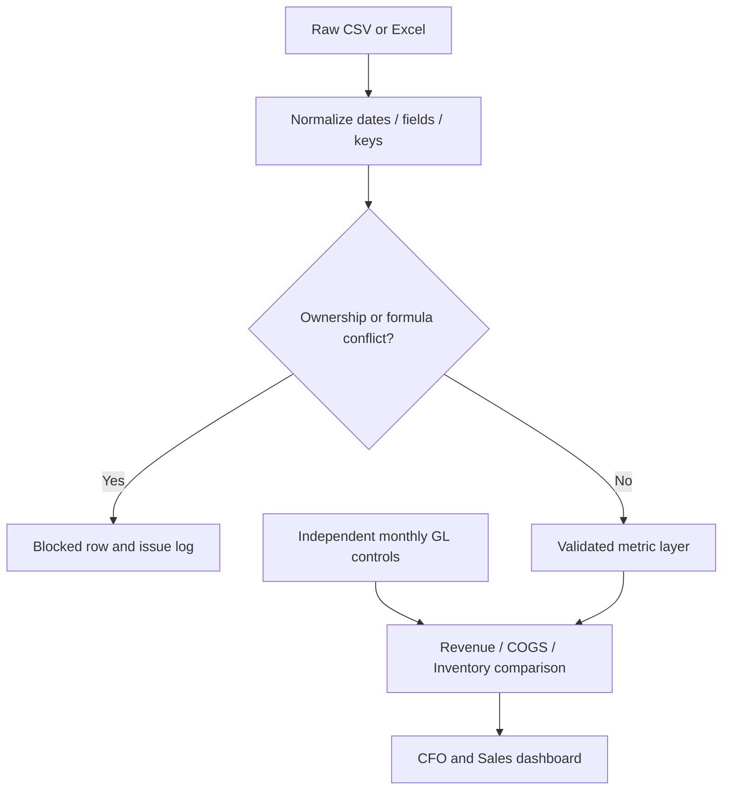

# ApexEdge Finance Intelligence Architecture

## Operating model

## Role responsibilities

| Role | Owns | Output |
| --- | --- | --- |
| Accounting / Controller | ERP record, cutoff, reconciliations, policy, GL controls | Reconciled reporting basis |
| AI Finance Analyst | Data pipeline, metric definitions, cost drivers, scenario logic, detection | Reusable profitability model and decision evidence |
| Sales VP / Commercial | Promotion, price, campaign input, execution and feedback | Commercial actions and measured impact |
| CFO | Resource allocation, thresholds, approval governance | Decision and risk accountability |

## Metric contracts

- Net Revenue = Gross Sales − Discounts − Returns.
- Gross Profit = Net Revenue − Product Cost − Freight − Tariffs (synthetic case accounting policy only).
- Contribution Profit = Gross Profit − Platform Fees − Marketing Spend.
- Every CFO and Sales view consumes the same canonical rows.
- Uploaded data uses month × SKU × Channel as a prototype key. Overlapping files with competing metric ownership are blocked.
- Inventory balances are month-end snapshots, not transaction flows.
- The gross-profit driver bridge compares the most recent two months and reconciles six additive effects.
- Real GL data is independent and optional; missing GL controls are never labeled PASS.

## Data lineage and reconciliation

## AI boundaries

- All dollars, ratios and differences are deterministic Python calculations.
- The optional OpenAI Responses API receives only previewed rounded aggregates after explicit user consent.
- The request sets `store: false`.
- The model explains observations and suggests hypotheses; it cannot post journal entries, change pricing or approve budgets.
- An authorized human must approve actions. Decision logs in the MVP are session-only and exportable.

## Production roadmap

SSO/RBAC; approved service connectors; immutable raw layer; immutable audit events; row-level lineage; durable decision database; task owner notifications; monitoring, rate limits and cost controls; scheduled GL refresh; activity-level costing inputs.
