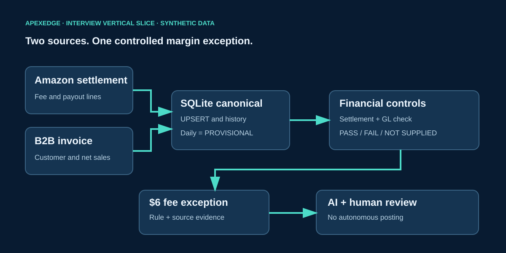

# ApexEdge Interview Slice: Reconciled Margin Exception

**Status:** runnable synthetic demo. No merchant API, ERP, daily scheduler, financial posting or actual business ROI.

## Two-minute architecture explanation

1. **Amazon and B2B simulated inputs:** both use a documented CSV contract. Production adapters require approved access; evaluate managed connectors before building custom ones.
2. **SQLite canonical storage:** composite (channel, record ID) key and transactional UPSERT make identical replay idempotent. Source update timestamps and load events allow historical backfill without reloading duplicates.
3. **Financial controls:** synthetic independent control totals for net sales, platform fees and cash due, plus settlement arithmetic checks. Missing GL means NOT SUPPLIED; a backfill against old controls means FAIL.
4. **Status distinction:** daily operating KPIs stay PROVISIONAL. Production monthly RECONCILED requires actual accounting policies, coverage, cutoff and Finance signoff.
5. **One exception:** Amazon order AMZ-1008 has $120 net sales, $18 expected fee, $24 actual fee, and $96 cash due. Settlement arithmetic balances; the fee-policy difference is $6 and its cause is unverified.
6. **AI with control:** deterministic calculation produces a numeric evidence packet. An optional LLM receives only aggregated metrics, suggests a hypothesis, and a human reviews it.

## Run

CLI: python thin_slice.py

Dashboard: streamlit run app.py

Select **Live Pipeline Demo / 财务数据闭环** in the sidebar.

- Default: two canonical rows; two insert events; zero new rows on identical replay.
- Synthetic GL control PASS while operational status is PROVISIONAL.
- Inspect $6 fee exception and the exact permitted AI evidence packet.
- Select late Amazon adjustment: fee becomes $20, cash due $100, one history event is added, and original GL controls turn FAIL.
- Disable GL control: status becomes NOT SUPPLIED.
- Mark investigated in the session. Optional LLM needs API key and explicit consent.

## Benefit scorecard: targets, not achievements

| KPI | Baseline to measure | Pilot target | Evidence |
|---|---|---|---|
| Monthly margin package | Actual cutoff-to-signoff days | 1 business day faster | Timestamped delivery and signoff |
| Manual reconciliation | Current hours per cycle | 25% fewer hours | Analyst work log |
| Exception investigation | Current median minutes | 30% faster | Case timestamps |
| Unexplained variance | Current unresolved dollars | Reduce unexplained dollars | Finance exception register |
| Margin leakage | Unknown initially | Quantify one validated fee leak | Source records and Finance approval |
| AI evidence | 30–50 human-labeled cases | >=95% evidence citation accuracy target | Gold set and error review |

Realized dollar value = verified hours saved × approved fully loaded hourly cost + realized net margin recovery – tool and maintenance costs. Detected variance is not recovered profit.

## Technical questions

**Idempotency and backfills.** Source-qualified unique keys and UPSERT; log changed source versions and reject older snapshots. Operational history may change with late refunds, but posted periods follow Accounting's adjustment and signoff policy. This demo does not post journals.

**Security.** Production tokens belong in managed secrets, with least-privilege read-only scopes, encrypted storage, environment separation and approved AI boundaries. Demo has no live secrets or private merchant records.

**Build versus buy.** Evaluate Fivetran, Airbyte and ERP-native connectors first. Concentrate custom development on financial definitions, reconciling controls, exception ownership and CFO/Sales workflows.

## Interview sequence: 12 minutes + 3 minutes Q&A

1. Two minutes: architecture; provisional versus reconciled.
2. Five minutes: import, replay, mock GL check, fee signal, optional AI packet, historical backfill → GL FAIL.
3. Three minutes: switch to existing CFO and Sales business views.
4. Two minutes: baseline, proposed targets, production dependencies.
5. Three minutes: Q&A on duplicate runs, adjustments, access and commercial benefit.

**Interview wording:** “I designed and tested this pipeline with simulated connectors. Live integrations require authorization, and I would validate rate limits, retries and historical backfills with IT.”

**Implemented:** simulated SQLite slice, controls, late revisions, evidence, session review, optional LLM and dashboard pages.

**Planned only:** live APIs, production scheduler, durable audit/permissions and measured business ROI.
